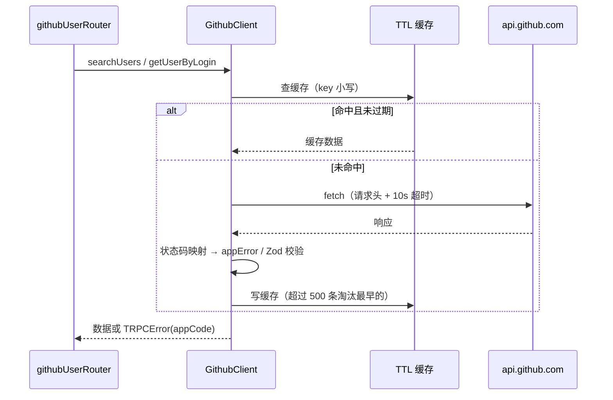

# R00 基础设施：数据模型、GitHub 客户端、错误码、测试框架 - 技术设计

> 技术参考：[AGENTS.md](../../AGENTS.md)　需求：[docs/需求.md](../../docs/需求.md) 第 5、6、8 节

## 技术约定

- pnpm workspace + Turborepo，依赖版本统一放在 `pnpm-workspace.yaml` 的 `catalog:`（AGENTS.md「技术栈」）
- 依赖方向 `apps/server` → `api` → `auth` → `db`；共享包不直接读取环境变量，只导出工厂函数，由 `apps/server/src/services.ts` 传入 `ENV` 创建单例（AGENTS.md「架构与数据流」·依赖注入）
- 内部包 `exports` 直接指向 `src/*.ts`，不单独构建（AGENTS.md「架构与数据流」）
- 新 router 放在 `packages/api/src/routers/` 并合并进 `appRouter`；需要登录的接口用 `protectedProcedure`（AGENTS.md「架构与数据流」·tRPC）
- Prisma 多文件 schema 放在 `packages/db/prisma/schema/`；改 schema 后执行 `db:generate`；`auth.prisma` 由 `auth:generate` 生成，不手改（AGENTS.md「架构与数据流」·数据库、「目录结构」）
- 环境变量在 `.env.schema` 中声明，改完执行 `pnpm run env:generate`，`src/env.ts` 不手改不提交；新增全局变量同时加进 `turbo.json` 的 `globalEnv`（AGENTS.md「环境变量（Varlock）」）
- Biome + Ultracite：Tab 缩进、双引号；用 `unknown` 不用 `any`；常量提到顶层；正则用顶层字面量；不写 barrel 文件（AGENTS.md「Ultracite Code Standards」）
- 测试：断言写在 `it()`/`test()` 里，用 async/await，不提交 `.only`/`.skip`，`describe` 不要嵌套过深（AGENTS.md「Testing」）
- 用 pnpm 管理依赖（AGENTS.md「注意事项」）

## 方案概述

1. **数据模型**：按 PRD 第 5 节原样新增 `github-user.prisma`，在新建的独立开发库 `zyk_aws_admin` 上用 `db:migrate` 生成第一个迁移（见「风险与取舍」第 1 条，已确认）。
2. **测试框架**：引入 Vitest（PRD 第 8 节明确要求）。需要数据库的测试连到同一个 PostgreSQL 实例上的独立测试库 `zyk_aws_admin_test`，不碰开发库。
3. **校验规则**：`packages/api/src/github/schemas.ts` 只依赖 `zod`（web 唯一允许运行时导入的 api 文件，见「风险与取舍」第 4 条），导出用户名、搜索关键字、备注、标签的规则，以及 GitHub 响应的 Zod 定义。
4. **GitHub 客户端**：`createGithubClient({ token, fetch, now })` 工厂函数，封装请求头、10 秒超时、Zod 校验、错误映射和 60 秒内存缓存。直接抛出带 `appCode` 的 `TRPCError`，router 不再做二次映射。
5. **错误码**：`packages/api/src/errors.ts` 定义 `AppCode` 和 `appError()` 帮助函数，业务信息放进 `TRPCError.cause`；`initTRPC.create({ errorFormatter })` 把它取出来放进 `error.data.appCode` / `error.data.resetAt`。
6. **上下文**：`Context` 增加 `github`，`apps/server` 负责组装。
7. **数据转换**：现有 tRPC 没有配置 transformer，`Date` 经 JSON 传到前端会变成字符串。技术参考未规定，暂按「接口输出前把日期统一转成 ISO 字符串」处理，在 `packages/api/src/github/mapper.ts` 里集中做，保证类型和实际数据一致，不引入 superjson。
8. **前端公共部分**：`apps/web/src/lib/app-error.ts` 统一把 `appCode` 转成中文提示；`utils/trpc.ts` 的全局 toast 支持通过 `meta.skipGlobalErrorToast` 跳过，让搜索、资料查询这类页面内展示错误的查询不重复弹 toast。

## 涉及模块 / 文件

| 文件 | 改动 |
| --- | --- |
| `apps/server/.env`（不提交） | `DATABASE_URL` 的库名改成 `zyk_aws_admin`，主机、端口、账号、密码不变 |
| `pnpm-workspace.yaml` | catalog 增加 `vitest`（取安装时的最新稳定版） |
| `package.json`（根） | 增加 `"test": "turbo run test"` |
| `turbo.json` | 增加 `test` 任务（依赖数据库，`cache: false`）；`globalEnv` 增加 `GITHUB_TOKEN` |
| `packages/db/prisma/schema/github-user.prisma` | 新增 `GithubUser` 模型（PRD 第 5 节原样） |
| `packages/db/prisma/migrations/<时间戳>_<名称>/migration.sql` | `db:migrate` 生成 |
| `packages/db/src/testing.ts` | 测试用（业务代码不导入）：`getTestDatabaseUrl(url)` 把库名改成 `<库名>_test`（即 `zyk_aws_admin_test`），其余不变；`prepareTestDatabase(url)` 连到配置的开发库执行集群级的 `CREATE DATABASE`（不存在时，不读写开发库的表），再以测试库地址执行 `prisma migrate deploy`；`createTestDatabase(url = process.env.DATABASE_URL)` 返回测试库的 Prisma 客户端；`resetTestDatabase(db)` 清空 public 下除 `_prisma_migrations` 外的所有表（含 `github_user` 和 auth 表，`RESTART IDENTITY CASCADE`）。后两者发现库名不以 `_test` 结尾时直接报错 |
| `packages/api/package.json` | 增加 `vitest`（dev）、`"test": "varlock run --path ../db/ -- vitest run"`（用 db 包的 `.env.schema` 注入 `DATABASE_URL`，varlock 用根目录已有的；现有 `exports` 的 `./*` → `./src/*.ts` 已覆盖 `./github/schemas`，不用另加） |
| `packages/api/vitest.config.ts` | `environment: "node"`、`include: src/**/*.test.ts`、`globalSetup`、`setupFiles`；配置文件本身不导入工作区包（Vitest 用原生 Node 加载配置，无法解析工作区里不带扩展名的 TS 导入） |
| `packages/api/vitest.global-setup.ts` | 调用 `prepareTestDatabase(process.env.DATABASE_URL)`，用 `project.provide("testDatabaseUrl", …)` 把测试库地址交给测试进程 |
| `packages/api/vitest.setup.ts` | `process.env.DATABASE_URL = inject("testDatabaseUrl")`，测试进程里的 `DATABASE_URL` 一律指向测试库 |
| `packages/api/src/errors.ts` | `AppCode` 常量、`AppErrorCause` 类、`appError(code, appCode, extra?)` |
| `packages/api/src/index.ts` | `initTRPC.context<Context>().create({ errorFormatter })` |
| `packages/api/src/github/schemas.ts` | `githubUsernameSchema`、`searchKeywordSchema`、`remarkSchema`、`tagsSchema`，以及 `githubSearchItemSchema`、`githubSearchResponseSchema`、`githubUserResponseSchema`（保留 GitHub 原始的 snake_case 字段名，可空文本字段缺失或为 null 时统一成 null，日期保持 ISO 字符串，由 mapper 转换）；导出类型 `GithubSearchItem`、`GithubSearchResponse`、`GithubProfile` 和长度上限常量 |
| `packages/api/src/github/cache.ts` | `createTtlCache({ ttlMs: 60_000, maxEntries: 500, now })`，基于 `Map` 插入顺序淘汰最早的条目 |
| `packages/api/src/github/client.ts` | `createGithubClient`、`GithubClient` 类型 |
| `packages/api/src/github/mapper.ts` | GitHub 资料 → Prisma 写入数据；Prisma 记录 → 接口输出（日期转 ISO 字符串） |
| `packages/api/src/context.ts` | `Context` 增加 `github: GithubClient` |
| `packages/api/src/routers/github-user.ts` | `export const githubUserRouter = router({})`，接口在 R02～R10 中逐个加入 |
| `packages/api/src/routers/index.ts` | `githubUser: githubUserRouter` |
| `apps/server/.env.schema` | `# @optional @sensitive` `GITHUB_TOKEN=`，注释写明「只读公开资料，不需要勾选权限；强烈建议配置，否则搜索每分钟 10 次、资料每小时 60 次」；随后 `pnpm run env:generate` |
| `apps/server/src/services.ts` | `export const github = createGithubClient({ token: ENV.GITHUB_TOKEN })` |
| `apps/server/src/context.ts` | 返回 `{ db, github, session }` |
| `apps/web/src/lib/app-error.ts` | `getAppCode(error)`、`getAppErrorMessage(error, scene)`、`formatResetTime(resetAt, withSeconds)` |
| `apps/web/src/utils/trpc.ts` | 全局 `QueryCache.onError` 遇到 `query.meta?.skipGlobalErrorToast` 时不弹 toast |
| 测试文件 | `packages/api/src/test-database.test.ts`（测试库冒烟：连的是 `_test` 库、迁移已执行、清表生效、拒绝非测试库）、`packages/api/src/github/client.test.ts`、`cache.test.ts`、`schemas.test.ts`、`packages/api/src/errors.test.ts` |

## 数据模型

按 PRD 第 5 节原样新增（不改字段、不加 `deletedAt`）：

```prisma
model GithubUser {
  id              Int      @id @default(autoincrement())
  githubId        Int      @unique
  login           String
  name            String?
  avatarUrl       String
  htmlUrl         String
  bio             String?
  company         String?
  blog            String?
  location        String?
  email           String?
  twitterUsername String?
  publicRepos     Int      @default(0)
  publicGists     Int      @default(0)
  followers       Int      @default(0)
  following       Int      @default(0)
  githubCreatedAt DateTime
  githubUpdatedAt DateTime
  remark          String?  @db.VarChar(500)
  tags            String[] @default([])
  createdById     String
  syncedAt        DateTime
  createdAt       DateTime @default(now())
  updatedAt       DateTime @updatedAt

  @@index([login])
  @@index([tags], type: Gin)
  @@index([createdAt])
  @@map("github_user")
}
```

- `createdById` 不建外键（PRD 第 5 节说明）。
- 从本需求开始用迁移管理表结构，不再使用 `db:push`。

## 接口设计

### 校验规则（`schemas.ts`，前后端共用）

```ts
// 用户名：1~39 位，字母数字和 -，不以 - 开头/结尾，无连续 --
const GITHUB_USERNAME_PATTERN = /^[a-z\d](?:[a-z\d]|-(?=[a-z\d])){0,38}$/i;
export const githubUsernameSchema = z.string().trim().regex(GITHUB_USERNAME_PATTERN, "用户名格式不正确");
export const searchKeywordSchema = z.string().trim().min(1, "请输入搜索关键字").max(100, "关键字最多 100 个字符");
export const remarkSchema = ...;  // R07 使用：trim，最多 500，空字符串转 null
export const tagsSchema = ...;    // R07 使用：每个 trim、去空、去重，最多 10 个、每个最多 20 字
```

### GitHub 客户端

```ts
type GithubClientOptions = { token?: string; fetch?: typeof fetch; now?: () => number };
type GithubClient = {
  searchUsers(input: { q: string; page: number }): Promise<{ total: number; items: GithubSearchItem[] }>;
  getUserByLogin(login: string, options?: { cache?: boolean }): Promise<GithubProfile>; // 默认走缓存
  getUserById(id: number): Promise<GithubProfile>; // 不走缓存
};
```

- 搜索：`GET https://api.github.com/search/users?q=<encodeURIComponent(关键字 + " type:user")>&per_page=10&page=<页码>`
- 资料：`GET /users/{encodeURIComponent(login)}`、`GET /user/{id}`
- 超时：`signal: AbortSignal.timeout(10_000)`

### 错误码（`errors.ts`）

| `appCode` | tRPC code | 来源 |
| --- | --- | --- |
| `GITHUB_USER_NOT_FOUND` | `NOT_FOUND` | PRD 6.3 |
| `GITHUB_RATE_LIMITED`（带 `resetAt`） | `TOO_MANY_REQUESTS` | PRD 6.3 |
| `GITHUB_SEARCH_RATE_LIMITED`（带 `resetAt`） | `TOO_MANY_REQUESTS` | PRD 6.3 |
| `GITHUB_SEARCH_INVALID` | `BAD_REQUEST` | PRD 6.3 |
| `GITHUB_UNAVAILABLE` | `BAD_GATEWAY` | PRD 6.3 |
| `GITHUB_USER_ALREADY_SAVED` | `CONFLICT` | 技术参考未规定，暂按此名，R04 使用 |
| `RECORD_NOT_FOUND` | `NOT_FOUND` | 技术参考未规定，暂按此名，用来和 GitHub 的 404 区分，R06～R09 使用 |

`resetAt` 为毫秒时间戳（`Number(x-ratelimit-reset) * 1000`）。`errorFormatter` 返回 `{ ...shape, data: { ...shape.data, appCode, resetAt } }`，没有业务错误码时 `appCode: null`。

### 前端提示映射（`app-error.ts`）

| `appCode` | 提示 |
| --- | --- |
| `GITHUB_USER_NOT_FOUND` | 查询/添加：「GitHub 上没有找到该用户」；同步：「该账号在 GitHub 上已不存在」 |
| `GITHUB_RATE_LIMITED` | 「GitHub 请求过于频繁，请在 HH:mm 之后重试」 |
| `GITHUB_SEARCH_RATE_LIMITED` | 「GitHub 搜索过于频繁，请在 HH:mm:ss 之后重试」 |
| `GITHUB_SEARCH_INVALID` | 「搜索关键字不合法，请修改后重试」（PRD 未规定文案，暂按此） |
| `GITHUB_UNAVAILABLE` | 「GitHub 暂时无法访问，请稍后重试」 |
| `GITHUB_USER_ALREADY_SAVED` | 「该用户已在名单中」 |
| `RECORD_NOT_FOUND` | 「记录不存在」 |
| 其他 | `error.message` |

时间按浏览器本地时区格式化。

## 关键流程



## 异常与边界情况

- 403 但 `x-ratelimit-remaining` 不为 0（例如被 GitHub 风控）：按 `GITHUB_UNAVAILABLE` 处理（技术参考未规定，暂按此）。
- 429 没有 `x-ratelimit-reset` 时，用 `retry-after` 秒数推算 `resetAt`；都没有时 `resetAt` 取当前时间 + 60 秒（暂按此）。
- 错误响应不写缓存；缓存过期条目在读取时删除。
- `fetch` 抛出 `TimeoutError`/`AbortError`/`TypeError`：统一映射为 `GITHUB_UNAVAILABLE`，原始错误放进 `cause` 方便排查，不返回给前端。
- 用户名里只有合法字符，但仍用 `encodeURIComponent` 拼路径。

## 风险与取舍

1. **开发数据库（已确认，方案 A）**：原开发库 `postgres` 里有另一个项目的迁移历史和 `person` 表，直接 `db:migrate` 会触发重置。处理：在同一 PostgreSQL 实例上新建 `zyk_aws_admin`（用户已授权建库，例如 `CREATE DATABASE zyk_aws_admin;`，用 `.env` 里原有的连接信息连到 `postgres` 库执行，只建库、不写其他数据）；把 `apps/server/.env` 里 `DATABASE_URL` 的库名改成 `zyk_aws_admin`（只改库名，`.env` 已被 gitignore，不提交）；然后在新库上生成第一个迁移（包含 auth 表和 `github_user` 表）。旧库 `postgres` 不做任何写操作，不重置；原有那 1 个账号在新库重新注册。
2. **新增依赖 Vitest**：PRD 第 8 节明确要求；加到 catalog，只作为 devDependency。
3. **测试库**：技术参考未规定测试数据库，按「同一 PostgreSQL 实例上的 `<库名>_test` 库」，即 `zyk_aws_admin_test`（用户已确认），`globalSetup` 自动创建并执行 `prisma migrate deploy`，每个测试文件开始前清空表。需要本机 PostgreSQL 用户有建库权限。
4. **web 运行时导入 `schemas.ts`（已确认）**：PRD 要求共享校验规则，和 AGENTS.md「web 只导入类型」冲突。用户已同意作为唯一例外：`apps/web` 只允许运行时导入 `packages/api/src/github/schemas.ts` 这一个文件，该文件只能依赖 `zod`，不得导入 db、auth、tRPC 等服务端代码。W8 文档同步时把这个例外写进 AGENTS.md。
5. **内存缓存**：只适用于单实例；开放注册后所有用户共享一个 token 的额度，缓存是节省额度的主要手段。多实例部署时需要换成共享缓存，放到部署讨论中。
6. **`githubId` 用 `Int`**：按 PRD 第 5 节，暂时够用。
