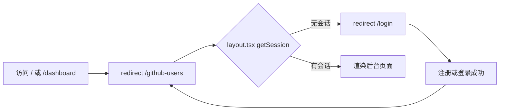

# R01 注册与登录（开放注册 + 限流 + 登录跳转） - 技术设计

> 技术参考：[AGENTS.md](../../AGENTS.md)　需求：[docs/需求.md](../../docs/需求.md) REQ-01

## 技术约定

- Better Auth 1.7 挂在 server 的 `/api/auth/*`，`createAuth(env, db)` 工厂函数在 `packages/auth/src/index.ts`（AGENTS.md「目录结构」「架构与数据流」·认证）
- web 在服务端组件里调用 `authClient.getSession({ fetchOptions: { headers } })` 判断是否登录（AGENTS.md「架构与数据流」·认证）
- 需要登录的接口用 `protectedProcedure`，没有会话时抛 `UNAUTHORIZED`（AGENTS.md「架构与数据流」·tRPC）
- 新增或调整 Better Auth 插件后要先 `auth:generate`（AGENTS.md「架构与数据流」·数据库）——本需求只改 `rateLimit` 配置、不加插件，且使用内存存储，不需要新表，因此不执行 `auth:generate`
- Next.js 16 的 API 写之前先查 `apps/web/node_modules/next/dist/docs/`（AGENTS.md「注意事项」）
- 表单用 TanStack Form + Zod（AGENTS.md「技术栈」）
- 测试用 Vitest（R00 引入）

## 方案概述

1. **限流**：`createAuth` 中加入
   ```ts
   rateLimit: {
     enabled: true, // 开发环境也开启
     customRules: {
       "/sign-up/email": { window: 60, max: 5 },
       "/sign-in/email": { window: 60, max: 5 },
     },
   }
   ```
   其他路径沿用 Better Auth 默认规则。存储用默认的内存存储（技术参考未规定，暂按此）。注册和登录**分别**计数（PRD 6.2 的写法是两条独立规则）。
   本地开发时请求不经过代理、没有 `x-forwarded-for`，Better Auth 1.7.12 在 development/test 环境会把 IP 记为 `127.0.0.1`（已核对 `@better-auth/core/dist/utils/ip.mjs`），因此本地同样按单个 IP 限流。
2. **自动登录**：Better Auth 默认 `autoSignIn` 为开启，保持不变；`emailAndPassword` 只保留 `enabled: true`。
3. **前端提示**：注册、登录表单的 `onError` 里按顺序判断：`error.error.status === 429` → 「操作过于频繁，请稍后再试」；`error.error.code` 为 `USER_ALREADY_EXISTS` 或 `USER_ALREADY_EXISTS_USE_ANOTHER_EMAIL` → 「该邮箱已注册」；其他 → 原消息。成功后 `router.push("/github-users")`。表单文案改成中文（技术参考未规定，暂按中文，和 PRD 提示语一致）。
4. **页面保护**：新建 `apps/web/src/app/github-users/layout.tsx`（服务端组件），沿用 `/dashboard` 的写法获取会话，没有就 `redirect("/login")`，覆盖该目录下所有页面。R05 之前 `github-users/page.tsx` 先放一个占位页。
5. **跳转**：`apps/web/src/app/page.tsx` 和 `apps/web/src/app/dashboard/page.tsx` 改为服务端 `redirect("/github-users")`；删除只服务于旧 dashboard 的 `apps/web/src/app/dashboard/dashboard.tsx`（PRD 6.4 明确要求这两个页面跳转，脚手架首页的 ASCII 标题和健康检查展示一起去掉）。`privateData` 和 `healthCheck` 接口保留不动。
6. **导航和退出**：`header.tsx` 导航改为只有「GitHub 用户」（`/github-users`）；`user-menu.tsx` 退出成功后 `router.push("/login")` 并 `router.refresh()`，避免已挂载的后台布局继续显示。
7. **README**：在根 `README.md` 增加「开放注册的风险」说明（PRD 第 8 节）。

## 涉及模块 / 文件

| 文件 | 改动 |
| --- | --- |
| `packages/auth/src/index.ts` | 加 `rateLimit` 配置 |
| `packages/auth/package.json` | 加 `vitest`（dev）和 `test` 脚本 |
| `packages/auth/vitest.config.ts` | 复用 R00 的测试库 `globalSetup` |
| `packages/auth/src/index.test.ts` | 限流、重复注册、自动登录、退出后会话失效 |
| `packages/api/src/routers/protected.test.ts` | 遍历 `githubUserRouter` 的全部 procedure，未登录调用都返回 `UNAUTHORIZED` |
| `apps/web/src/components/sign-up-form.tsx` / `sign-in-form.tsx` | 跳转目标、429 和重复邮箱提示、中文文案 |
| `apps/web/src/app/github-users/layout.tsx` | 新增：服务端会话校验 |
| `apps/web/src/app/github-users/page.tsx` | 新增占位页（R05 替换为名单列表） |
| `apps/web/src/app/page.tsx` | 改为 `redirect("/github-users")` |
| `apps/web/src/app/dashboard/page.tsx` | 改为 `redirect("/github-users")` |
| `apps/web/src/app/dashboard/dashboard.tsx` | 删除 |
| `apps/web/src/components/header.tsx` | 导航「GitHub 用户」 |
| `apps/web/src/components/user-menu.tsx` | 退出后跳 `/login` |
| `README.md` | 开放注册风险说明 |

## 数据模型

无（限流用内存存储，不新增表）。

## 接口设计

- Better Auth：`POST /api/auth/sign-up/email`、`POST /api/auth/sign-in/email`，超限返回 `429`（带 `X-Retry-After`）。
- tRPC：不新增接口；`githubUser.*` 全部使用 `protectedProcedure`（R02～R10 新增接口时都要满足，`protected.test.ts` 会自动覆盖新增的接口）。

## 关键流程



## 异常与边界情况

- 注册接口被限流时，前端不要再显示「该邮箱已注册」等其他提示，只显示限流提示。
- 已登录用户访问 `/login`：不强制跳转（PRD 未要求），保留现状。
- `getSession` 请求失败（server 未启动）：`throw: true` 会抛错，交给 Next.js 错误页，和现有 `/dashboard` 行为一致。
- 测试里 `NODE_ENV=test`，Better Auth 按 `127.0.0.1` 计数；测试需要不同 IP 时设置 `x-forwarded-for` 请求头。每个测试新建 `createAuth` 实例，避免内存计数互相影响。

## 风险与取舍

- **内存限流存储**：服务重启后计数清零，多实例时各算各的。本期只保证本地开发可用（PRD 2.2），部署时再换成数据库或二级存储。
- **`x-forwarded-for` 可伪造**：Better Auth 默认信任该请求头，直接暴露的服务可以被绕过限流。本地开发可接受；部署时需要配置 `advanced.ipAddress` 和可信代理，记入部署讨论。
- **开放注册**：任何注册用户都能改删全部数据、消耗共享的 GitHub 额度，PRD 已接受此风险（D1），在 README 中写明。
- **删除 `dashboard.tsx`**：属于删除功能，PRD 6.4 已明确 `/dashboard` 改为跳转，在此写明，不再单独确认。
