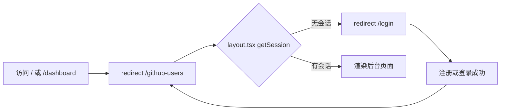

# R01 注册与登录（开放注册 + 限流 + 登录跳转） - 技术设计

> 技术参考：[AGENTS.md](../../AGENTS.md)　需求：[docs/需求.md](../../docs/需求.md) REQ-01

## 技术约定

- Better Auth 1.7 挂在 server 的 `/api/auth/*`，`createAuth(env, db)` 工厂函数在 `packages/auth/src/index.ts`（AGENTS.md「目录结构」「架构与数据流」·认证）
- web 在服务端组件里调用 `authClient.getSession({ fetchOptions: { headers } })` 判断是否登录（AGENTS.md「架构与数据流」·认证）
- 需要登录的接口用 `protectedProcedure`，没有会话时抛 `UNAUTHORIZED`（AGENTS.md「架构与数据流」·tRPC）
- 新增或调整 Better Auth 插件后要先 `auth:generate`（AGENTS.md「架构与数据流」·数据库）——本需求只改 `rateLimit` 配置、不加插件，且使用内存存储，不需要新表，因此不执行 `auth:generate`
- Next.js 16 的 API 写之前先查 `apps/web/node_modules/next/dist/docs/`（AGENTS.md「注意事项」）
- 表单用 TanStack Form + Zod（AGENTS.md「技术栈」）
- 测试用 Vitest（R00 引入）

## 方案概述

1. **限流**：`createAuth` 中加入
   ```ts
   rateLimit: {
     enabled: true, // 开发环境也开启
     customRules: {
       "/sign-up/email": { window: 60, max: 5 },
       "/sign-in/email": { window: 60, max: 5 },
     },
   }
   ```
   其他路径沿用 Better Auth 默认规则。存储用默认的内存存储（技术参考未规定，暂按此）。注册和登录**分别**计数（PRD 6.2 的写法是两条独立规则）。
   本地开发时请求不经过代理、没有 `x-forwarded-for`，Better Auth 1.7.12 在 development/test 环境会把 IP 记为 `127.0.0.1`（已核对 `@better-auth/core/dist/utils/ip.mjs`），因此本地同样按单个 IP 限流。
2. **自动登录**：Better Auth 默认 `autoSignIn` 为开启，保持不变；`emailAndPassword` 只保留 `enabled: true`。
3. **前端提示**：注册、登录表单的 `onError` 里按顺序判断：`error.error.status === 429` → 「操作过于频繁，请稍后再试」；`error.error.code` 为 `USER_ALREADY_EXISTS` 或 `USER_ALREADY_EXISTS_USE_ANOTHER_EMAIL` → 「该邮箱已注册」；其他 → 原消息。成功后 `router.push("/github-users")`。表单文案改成中文（技术参考未规定，暂按中文，和 PRD 提示语一致）。判断逻辑抽到 `apps/web/src/lib/auth-error.ts` 的 `getAuthErrorMessage`，两个表单共用。
4. **页面保护**（2026-11-11 用户同意 CR 修复）：抽取服务端 `apps/web/src/lib/require-session.ts` 的 `requireSession()`，通过请求头调用 `authClient.getSession`（`cache: "no-store"`、`throw: true`），没有会话就 `redirect("/login")`。用 React `cache()` 在单次服务端渲染内去重。`github-users/layout.tsx` 和名单、添加、详情各自的 `page.tsx` 均调用它；Next.js 客户端导航会复用布局，不能仅依靠布局检查会话。R02、R05、R06 替换占位页面时保留页面级检查。R05 之前 `github-users/page.tsx` 先放一个占位页。
5. **跳转**：`apps/web/src/app/page.tsx` 和 `apps/web/src/app/dashboard/page.tsx` 改为服务端 `redirect("/github-users")`；删除只服务于旧 dashboard 的 `apps/web/src/app/dashboard/dashboard.tsx`（PRD 6.4 明确要求这两个页面跳转，脚手架首页的 ASCII 标题和健康检查展示一起去掉）。`privateData` 和 `healthCheck` 接口保留不动。
6. **导航和退出**：`header.tsx` 导航改为只有「GitHub 用户」（`/github-users`）；`user-menu.tsx` 退出成功后 `router.push("/login")` 并 `router.refresh()`，避免已挂载的后台布局继续显示。
7. **README**：在根 `README.md` 增加「开放注册的风险」说明（PRD 第 8 节）。

任务 7 浏览器验收补充：不存在的子路由会直接进入根 404，不经过 `github-users/layout.tsx`。因此提前为 `/github-users/new` 和 `/github-users/[id]` 添加服务端占位页，使 AC4 的三个路径均经过现有登录校验；R02、R06 分别替换对应占位页，不改变鉴权逻辑。

## 涉及模块 / 文件

| 文件 | 改动 |
| --- | --- |
| `packages/auth/src/index.ts` | 加 `rateLimit` 配置 |
| `packages/auth/package.json` | 加 `vitest`（dev）和 `test` 脚本 |
| `packages/auth/vitest.config.ts` / `vitest.global-setup.ts` / `vitest.setup.ts` | 沿用 R00 api 的写法（`globalSetup` 准备测试库），但用独立的测试库 `<库名>_auth_test`（见「异常与边界情况」） |
| `packages/db/src/testing.ts` | `getTestDatabaseUrl`、`prepareTestDatabase` 增加可选参数 `suffix`（默认 `_test`，必须以 `_test` 结尾），供 auth 使用独立测试库；api 不传参，行为不变 |
| `packages/api/src/test-database.test.ts` | 补 `suffix` 参数的用例 |
| `packages/auth/src/index.test.ts` | 限流、重复注册、自动登录、退出后会话失效 |
| `packages/api/src/routers/protected.test.ts` | 遍历 `githubUserRouter` 的全部 procedure，未登录调用都返回 `UNAUTHORIZED` |
| `apps/web/src/components/sign-up-form.tsx` / `sign-in-form.tsx` | 跳转目标、429 和重复邮箱提示、中文文案 |
| `apps/web/src/lib/auth-error.ts` | 新增：Better Auth 客户端错误转中文提示（限流 → 邮箱已注册 → 原消息） |
| `apps/web/src/lib/require-session.ts` | 新增：请求内去重的服务端会话检查，无会话跳登录 |
| `apps/web/src/app/github-users/layout.tsx` | 新增：调用 `requireSession()`；每个后台 page 也单独调用 |
| `apps/web/src/app/github-users/new/page.tsx` / `apps/web/src/app/github-users/[id]/page.tsx` | 提前创建占位页，并执行页面级会话校验 |
| `apps/web/src/app/github-users/page.tsx` | 新增占位页（R05 替换为名单列表）。任务 2 提前创建：web 开启了 `typedRoutes`，`router.push("/github-users")` 要求该路由存在，否则 `check-types` 不通过；任务 3 只需补 `layout.tsx` |
| `apps/web/src/app/page.tsx` | 改为 `redirect("/github-users")` |
| `apps/web/src/app/dashboard/page.tsx` | 改为 `redirect("/github-users")` |
| `apps/web/src/app/dashboard/dashboard.tsx` | 删除 |
| `apps/web/src/components/header.tsx` | 导航「GitHub 用户」 |
| `apps/web/src/components/user-menu.tsx` | 退出后跳 `/login` |
| `README.md` | 开放注册风险说明 |

## 数据模型

无（限流用内存存储，不新增表）。

## 接口设计

- Better Auth：`POST /api/auth/sign-up/email`、`POST /api/auth/sign-in/email`，超限返回 `429`（带 `X-Retry-After`）。
- tRPC：不新增接口；`githubUser.*` 全部使用 `protectedProcedure`（R02～R10 新增接口时都要满足，`protected.test.ts` 会自动覆盖新增的接口）。

## 关键流程



## 异常与边界情况

- 注册接口被限流时，前端不要再显示「该邮箱已注册」等其他提示，只显示限流提示。
- 已登录用户访问 `/login`：不强制跳转（PRD 未要求），保留现状。
- `getSession` 请求失败（server 未启动）：`throw: true` 会抛错，交给 Next.js 错误页，和现有 `/dashboard` 行为一致。
- 测试里 `NODE_ENV=test`，Better Auth 按 `127.0.0.1` 计数；测试需要不同 IP 时设置 `x-forwarded-for` 请求头。注意：Better Auth 1.7.12 的内存限流存储是模块级的 `Map`（键为 `IP|路径`，见 `better-auth/dist/api/rate-limiter/index.mjs`），同一进程内多个 `createAuth` 实例**共享**计数，新建实例不能隔离；因此每个测试用例使用各自唯一的 `x-forwarded-for` IP 来隔离计数。
- `turbo run test` 会并行跑 api 和 auth 的测试。两边都在 `beforeEach` 里 `resetTestDatabase` 清空全部表，共用 `<库名>_test` 时会互相清掉对方刚写入的用户（api 的「清空后 user 为 0」也会被 auth 的注册打破）。因此 auth 用独立的测试库 `<库名>_auth_test`，由 `prepareTestDatabase(url, "_auth_test")` 创建并迁移；后缀仍以 `_test` 结尾，`createTestDatabase`、`resetTestDatabase` 的非测试库保护照常生效。

## 风险与取舍

- **内存限流存储**：服务重启后计数清零，多实例时各算各的。本期只保证本地开发可用（PRD 2.2），部署时再换成数据库或二级存储。
- **`x-forwarded-for` 可伪造**：Better Auth 默认信任该请求头，直接暴露的服务可以被绕过限流。本地开发可接受；部署时需要配置 `advanced.ipAddress` 和可信代理，记入部署讨论。
- **开放注册**：任何注册用户都能改删全部数据、消耗共享的 GitHub 额度，PRD 已接受此风险（D1），在 README 中写明。
- **删除 `dashboard.tsx`**：属于删除功能，PRD 6.4 已明确 `/dashboard` 改为跳转，在此写明，不再单独确认。
