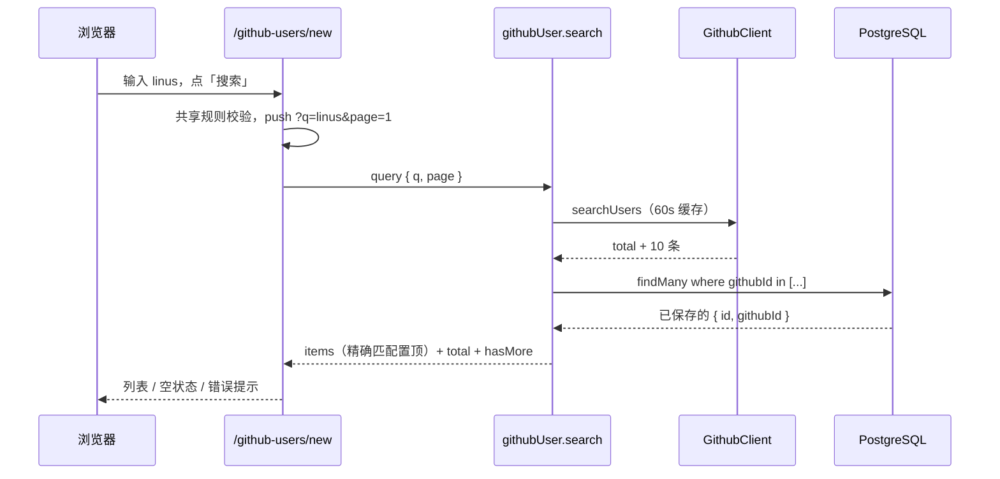

# R02 模糊搜索 GitHub 用户 - 技术设计

> 技术参考：[AGENTS.md](../../AGENTS.md)　需求：[docs/需求.md](../../docs/需求.md) REQ-02、第 7 节

## 技术约定

- 新接口加在 `packages/api/src/routers/github-user.ts` 的 `githubUserRouter`，用 `protectedProcedure`，输入用 Zod（AGENTS.md「架构与数据流」·tRPC）
- 前端数据请求用 `useTRPC()` + TanStack Query（AGENTS.md「技术栈」「目录结构」·`utils/trpc.ts`）
- 表单用 TanStack Form + Zod 4（AGENTS.md「技术栈」）
- 共享 UI 组件用 `npx shadcn@latest add <组件> -c packages/ui` 添加，从 `@zyk-aws-admin/ui/components/<name>` 导入（AGENTS.md「注意事项」）
- 图片用 Next.js `<Image>`；外链 `target="_blank"` 加 `rel="noopener noreferrer"`（AGENTS.md「Framework-Specific Guidance」「Security」）
- 使用语义化 HTML，表单输入有 label（AGENTS.md「React & JSX」）
- Next.js 16：页面的 `searchParams` 是 Promise，写之前查 `apps/web/node_modules/next/dist/docs/`（AGENTS.md「注意事项」）

## 方案概述

- **后端** `githubUser.search`：校验输入 → `ctx.github.searchUsers({ q, page })`（R00 的客户端负责缓存和错误映射）→ 用本页的 `githubId` 列表批量查 `githubUser` 表得到 `savedId` → 计算 `exactMatch`（`login.toLowerCase() === q.toLowerCase()`）→ 把精确匹配项移到本页第一位，其余保持 GitHub 原顺序 → 返回。
  - `hasMore = page * 10 < Math.min(total, 1000)`。
  - `savedId` 不进缓存：缓存的是 GitHub 原始结果，`savedId` 每次都按数据库现状计算。
- **前端** `/github-users/new`：`page.tsx` 是服务端组件，读取 `searchParams`；有 `username` 时显示资料预览（R03），否则显示搜索。搜索表单提交时只更新 URL（`router.push("?q=...&page=1")`），结果组件根据 URL 中的 `q`、`page` 发起查询，所以浏览器后退、从预览返回都能还原结果。
  - 查询选项：`staleTime: 60_000`、`refetchOnWindowFocus: false`、`retry: false`（限流时重试只会浪费额度）、`meta: { skipGlobalErrorToast: true }`（错误在页面内显示）。
  - URL 中的 `q`、`page` 先用共享规则校验，不合法（空、超长、页码不是 1～100 的整数）时不发请求：关键字不合法显示表单提示，页码不合法按第 1 页处理。
- **界面**：搜索框 + 「搜索」按钮（`<form>`，回车即提交）；结果列表每行是一个链接到预览的条目，显示头像（`<Image>`，40×40）、用户名、「精确匹配」「已在名单中」徽标、GitHub 主页外链；底部显示总数和「上一页」「下一页」。

## 涉及模块 / 文件

| 文件 | 改动 |
| --- | --- |
| `packages/api/src/routers/github-user.ts` | 新增 `search` |
| `packages/api/src/routers/github-user.search.test.ts` | 新增测试 |
| `apps/web/next.config.ts` | `images.remotePatterns` 允许 `https://avatars.githubusercontent.com/**` |
| `packages/ui/src/components/` | `npx shadcn@latest add avatar badge -c packages/ui`（翻页用现有 `button`） |
| `apps/web/src/app/github-users/new/page.tsx` | 新增：读取 `searchParams`，按 `username` 有无切换搜索/预览 |
| `apps/web/src/app/github-users/new/github-search.tsx` | 新增（客户端）：搜索表单 + 结果列表 + 翻页 |
| `apps/web/src/components/github-users/github-avatar.tsx` | 新增：头像组件（`<Image>`，alt 为用户名），R03/R05/R06 复用 |
| `apps/web/src/app/github-users/page.tsx` | 占位页加「添加用户」链接到 `/github-users/new`（R05 再完善） |

## 数据模型

无变化（只读 `githubUser.githubId`、`githubUser.id`）。

## 接口设计

```ts
githubUser.search: protectedProcedure
  .input(z.object({
    q: searchKeywordSchema,
    page: z.number().int().min(1).max(100).default(1),
  }))
  .query(...) => {
    items: { githubId: number; login: string; avatarUrl: string; htmlUrl: string; savedId: number | null; exactMatch: boolean }[];
    total: number;   // GitHub 的 total_count
    page: number;
    hasMore: boolean;
  }
```

错误：`BAD_REQUEST`（输入不合法、`GITHUB_SEARCH_INVALID`）、`TOO_MANY_REQUESTS`（`GITHUB_SEARCH_RATE_LIMITED` + `resetAt`）、`BAD_GATEWAY`（`GITHUB_UNAVAILABLE`）、`UNAUTHORIZED`。

PRD 第 7 节「`page × 10` 超过 1000 时返回 `BAD_REQUEST`」由 `page` 最大 100 的输入校验保证。

## 关键流程



## 异常与边界情况

- 总数为 0：显示「没有找到匹配的 GitHub 用户」。
- 总数 > 1000：在总数旁提示「结果太多，请输入更具体的关键字」，第 100 页时「下一页」禁用。
- 精确匹配的人不在当前页：不跨页提升，PRD 只要求「本页第一位」。
- GitHub 返回的 `incomplete_results: true`：忽略，按返回内容展示（技术参考未规定，暂按此）。
- 关键字含 `type:org` 等 GitHub 限定符：原样传给 GitHub，追加的 `type:user` 仍生效；不合法时 GitHub 返回 422 → `GITHUB_SEARCH_INVALID`。
- 限流提示中的时间：`resetAt` 按浏览器本地时区格式化为 `HH:mm:ss`。

## 风险与取舍

- 搜索额度极少且所有用户共享：靠按钮触发 + 服务端 60 秒缓存 + 前端 `staleTime` + 关闭重试来节省。
- 新增 shadcn 组件 `avatar`、`badge`：PRD 6.4 已列出，属于 `packages/ui` 内的源码组件，不新增 npm 依赖（如果 shadcn 生成的组件引入了新依赖，在 W4 时暂停确认）。

## 实现补充

- 2026-11-11：API 包新增数据库测试文件后，Vitest 设为 `fileParallelism: false`，避免多个文件同时 reset 共用测试库；包之间仍使用各自测试库。
- 搜索表单与反馈复用 shadcn Field/Alert/Separator 源码；生成时保留已有 Label，不新增依赖。GithubAvatar 监听 Next Image 优化图的实际加载错误，失败时显示用户名缩写。
- URL 构造和页码解析放在 `new/search-params.ts`；旧生产构建的路由类型与开发类型可能不一致，使用 `pnpm -F web exec next typegen` 重新生成。

## 已确认决策（2026-11-11）

- 用户同意：仅 `GithubAvatar` 的 Next Image 在 `NODE_ENV === "development"` 时设置 `unoptimized`，绕过本机 Fake-IP 与服务端图片优化的冲突；生产仍使用默认优化，代理/DNS 与私网保护配置不改。开发时浏览器直接加载公开头像图片；GitHub API 请求仍全部由服务端发起（AC10）。
