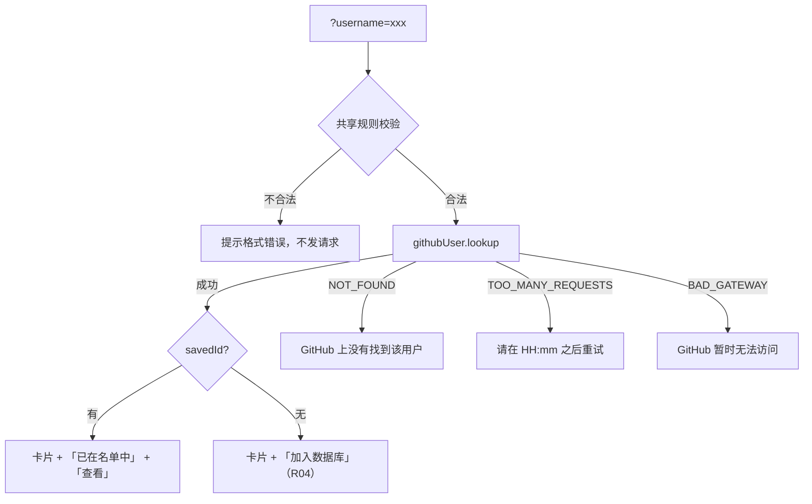

# R03 查看 GitHub 用户资料 - 技术设计

> 技术参考：[AGENTS.md](../../AGENTS.md)　需求：[docs/需求.md](../../docs/需求.md) REQ-03、第 7 节

## 技术约定

- 接口加在 `githubUserRouter`，`protectedProcedure` + Zod 输入（AGENTS.md「架构与数据流」·tRPC）
- 前端用 `useTRPC()` + TanStack Query（AGENTS.md「技术栈」）
- 共享 UI 组件从 `@zyk-aws-admin/ui/components/<name>` 导入（AGENTS.md「注意事项」）
- 不用 `dangerouslySetInnerHTML`；`target="_blank"` 加 `rel="noopener"`（PRD 要求 `noopener noreferrer`）；图片用 `<Image>`（AGENTS.md「Security」「Framework-Specific Guidance」）
- 正则用顶层字面量（AGENTS.md「Performance」）

## 方案概述

- **后端** `githubUser.lookup`：`githubUsernameSchema` 校验 → `ctx.github.getUserByLogin(username)`（走 60 秒缓存）→ 用返回的 `githubId` 查 `githubUser` 得到 `savedId` → 输出 `toProfileDto(profile)` + `savedId`。
  - 用 `githubId` 判断是否已保存：GitHub 用户名可以改，数字 ID 不变，比按用户名判断更准确。PRD 第 5 节「按用户名判断时用 `mode: "insensitive"`」只在按用户名查询的场景适用，这里不需要。
- **前端**：`/github-users/new/page.tsx` 发现 `username` 参数时渲染 `github-preview.tsx`（客户端）。组件先用 `githubUsernameSchema` 校验，不合法直接显示「用户名格式不正确」，不发请求；合法则查询 `lookup`（`staleTime: 60_000`、`refetchOnWindowFocus: false`、`retry: false`、`skipGlobalErrorToast`）。
- **资料卡片** `apps/web/src/components/github-users/github-profile-card.tsx`：只负责展示 GitHub 资料，操作区通过 `children`（或 `actions` 插槽）由调用方传入，R06 详情页复用同一张卡片。
- **返回搜索结果**：链接到 `/github-users/new?q=<q>&page=<page>`（取当前 URL 里的 `q`、`page`；没有时链接到 `/github-users/new`）。
- **博客链接**：`const SAFE_URL_PATTERN = /^https?:\/\//i;` 符合才渲染 `<a>`；GitHub 常见的不带协议的博客地址（如 `example.com`）显示为纯文本（技术参考未规定，暂按此，不自动补 `https://`）。
- **Twitter**：显示 `@用户名`，链接到 `https://x.com/<用户名>`（技术参考未规定，暂按此）。
- **日期**：GitHub 注册时间按 `YYYY-MM-DD` 显示。

## 涉及模块 / 文件

| 文件 | 改动 |
| --- | --- |
| `packages/api/src/routers/github-user.ts` | 新增 `lookup` |
| `packages/api/src/routers/github-user.lookup.test.ts` | 新增测试 |
| `apps/web/src/app/github-users/new/page.tsx` | 有 `username` 时渲染预览 |
| `apps/web/src/app/github-users/new/github-preview.tsx` | 新增（客户端）：校验、查询、状态、「返回搜索结果」、「已在名单中」/「查看」 |
| `apps/web/src/components/github-users/github-profile-card.tsx` | 新增：资料卡片 |
| `apps/web/src/components/github-users/external-link.tsx` | 新增：安全外链（`target="_blank" rel="noopener noreferrer"`，只接受 http/https） |

## 数据模型

无变化。

## 接口设计

```ts
githubUser.lookup: protectedProcedure
  .input(z.object({ username: githubUsernameSchema }))
  .query(...) => GithubProfileDto & { savedId: number | null }

type GithubProfileDto = {
  githubId: number; login: string; name: string | null; avatarUrl: string; htmlUrl: string;
  bio: string | null; company: string | null; blog: string | null; location: string | null;
  email: string | null; twitterUsername: string | null;
  publicRepos: number; publicGists: number; followers: number; following: number;
  githubCreatedAt: string; githubUpdatedAt: string; // ISO 字符串
};
```

错误：`BAD_REQUEST`、`NOT_FOUND`（`GITHUB_USER_NOT_FOUND`）、`TOO_MANY_REQUESTS`（`GITHUB_RATE_LIMITED` + `resetAt`）、`BAD_GATEWAY`（`GITHUB_UNAVAILABLE`）、`UNAUTHORIZED`。

## 关键流程



## 异常与边界情况

- GitHub 返回组织账号（`type: "Organization"`）：直接访问组织名时 `/users/{name}` 也会返回资料。PRD 未规定，暂按正常展示（搜索入口只会列出个人用户）。
- `GITHUB_USER_NOT_FOUND` 在预览场景提示「GitHub 上没有找到该用户」。
- 字段为 `null` 或空字符串：显示「—」。
- 用户名首尾空格：`githubUsernameSchema` 会先 trim。

## 风险与取舍

- 资料查询额度每小时 60 次（无 token）：靠 60 秒缓存和关闭重试节省；`apps/server/.env.schema` 中 `GITHUB_TOKEN` 的注释（R00）写明强烈建议配置。
