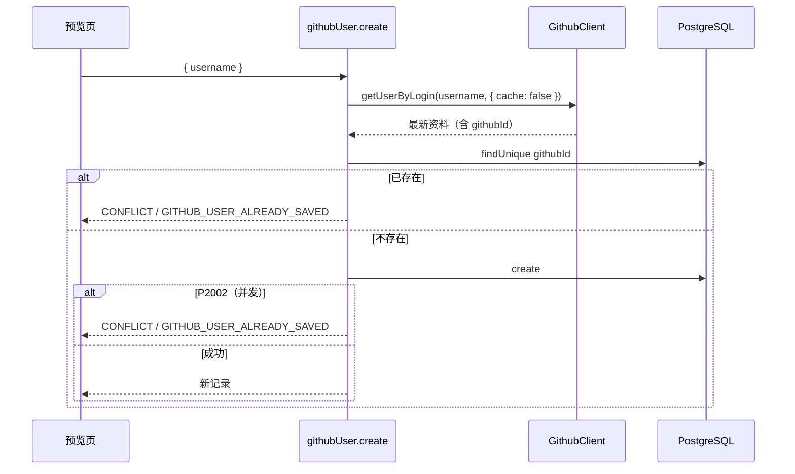

# R04 加入数据库 - 技术设计

> 技术参考：[AGENTS.md](../../AGENTS.md)　需求：[docs/需求.md](../../docs/需求.md) REQ-04、第 7 节

## 技术约定

- 接口加在 `githubUserRouter`，`protectedProcedure`，`ctx.session` 保证非空（AGENTS.md「架构与数据流」·tRPC）
- 数据库访问通过上下文中的 `ctx.db`（Prisma 7，`@prisma/adapter-pg`）（AGENTS.md「技术栈」「架构与数据流」）
- 前端用 `useTRPC()` + TanStack Query，变更成功后让相关查询失效（AGENTS.md「技术栈」；PRD 6.4）
- 增删改的错误在各自的地方处理，不依赖全局 toast（PRD 6.4；现有 `utils/trpc.ts` 只对查询弹 toast）

## 方案概述

`githubUser.create({ username })`：

1. `githubUsernameSchema` 校验。
2. `ctx.github.getUserByLogin(username, { cache: false })`：不读缓存，确保保存的是最新资料。
3. `ctx.db.githubUser.findUnique({ where: { githubId } })`，存在就抛 `CONFLICT` / `GITHUB_USER_ALREADY_SAVED`。
4. `ctx.db.githubUser.create({ data: { ...toGithubUserData(profile), createdById: ctx.session.user.id, syncedAt: new Date() } })`。
5. 捕获 Prisma 唯一约束错误（`P2002`，目标为 `githubId`）→ 同样抛 `CONFLICT` / `GITHUB_USER_ALREADY_SAVED`，防止并发重复。
6. 返回 `toRecordDto(record)`（日期转 ISO 字符串）。

前端：预览卡片的「加入数据库」按钮调用 `useMutation(trpc.githubUser.create.mutationOptions())`；成功后 `toast.success("已添加")`，并让 `githubUser.lookup`、`githubUser.search`、`githubUser.list`、`githubUser.tags` 的查询失效（预览重新显示「已在名单中」）。失败时按 `appCode` 用 `toast.error` 显示提示；`CONFLICT` 时同样让 `lookup` 失效，卡片切换为「已在名单中」。

`P2002` 的判断：Prisma 7 的错误类从生成的客户端导出（`Prisma.PrismaClientKnownRequestError`），W4 时按 `packages/db` 实际导出的路径引入；如果 db 包没有导出，在 `packages/db/src/index.ts` 增加一个 `isUniqueConstraintError(error)` 帮助函数（技术参考未规定，暂按此）。

## 涉及模块 / 文件

| 文件 | 改动 |
| --- | --- |
| `packages/api/src/routers/github-user.ts` | 新增 `create` |
| `packages/db/src/index.ts` | 视情况导出 `isUniqueConstraintError` / `isRecordNotFoundError`（R09 也用） |
| `packages/api/src/routers/github-user.create.test.ts` | 新增测试 |
| `apps/web/src/app/github-users/new/github-preview.tsx` | 「加入数据库」按钮和变更处理 |

## 数据模型

无变化。写入字段：`toGithubUserData(profile)` 映射 GitHub 字段（`githubId`、`login`、`name`、`avatarUrl`、`htmlUrl`、`bio`、`company`、`blog`、`location`、`email`、`twitterUsername`、`publicRepos`、`publicGists`、`followers`、`following`、`githubCreatedAt`、`githubUpdatedAt`），外加 `createdById`、`syncedAt`；`remark` 为空，`tags` 为 `[]`。

## 接口设计

```ts
githubUser.create: protectedProcedure
  .input(z.object({ username: githubUsernameSchema }))
  .mutation(...) => GithubUserRecordDto

type GithubUserRecordDto = GithubProfileDto & {
  id: number; remark: string | null; tags: string[]; createdById: string;
  syncedAt: string; createdAt: string; updatedAt: string; // ISO 字符串
};
```

错误：`BAD_REQUEST`、`NOT_FOUND`（`GITHUB_USER_NOT_FOUND`）、`CONFLICT`（`GITHUB_USER_ALREADY_SAVED`）、`TOO_MANY_REQUESTS`（`GITHUB_RATE_LIMITED`）、`BAD_GATEWAY`（`GITHUB_UNAVAILABLE`）、`UNAUTHORIZED`。

## 关键流程



## 异常与边界情况

- GitHub 调用失败时不写数据库（先拉资料再写库）。
- 先查后插之间有并发窗口，由 `githubId` 唯一约束 + `P2002` 捕获兜底。
- 物理删除后重新添加同一个人：没有 `deletedAt`，唯一约束不会冲突（R09 测试覆盖）。
- `create` 不走缓存，但成功后不回写缓存（缓存只给只读查询用）。

## 风险与取舍

- 添加接口会消耗一次资料查询额度（不走缓存）：PRD 明确要求，保证数据一致。
