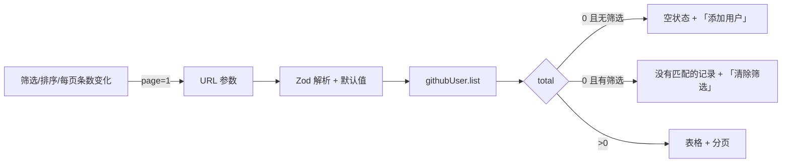

# R05 名单列表 - 技术设计

> 技术参考：[AGENTS.md](../../AGENTS.md)　需求：[docs/需求.md](../../docs/需求.md) REQ-05、第 7 节

## 技术约定

- 接口加在 `githubUserRouter`，`protectedProcedure` + Zod 输入（AGENTS.md「架构与数据流」·tRPC）
- Prisma 7 查询通过 `ctx.db`（AGENTS.md「技术栈」）
- 前端 `useTRPC()` + TanStack Query；共享组件用 shadcn 添加到 `packages/ui`（AGENTS.md「注意事项」）
- Next.js 16 `searchParams` 为 Promise，`typedRoutes` 开启（AGENTS.md「技术栈」「注意事项」）
- 列表用唯一 ID 作为 `key`（AGENTS.md「React & JSX」）

## 方案概述

- **`githubUser.list`**：
  ```ts
  where = {
    AND: [
      q ? { OR: [login, name, company, remark].map((f) => ({ [f]: { contains: q, mode: "insensitive" } })) } : {},
      tag ? { tags: { has: tag } } : {},
    ],
  }
  orderBy = [{ [sort]: order }, { id: order }] // 加 id 保证翻页顺序稳定
  ```
  用 `ctx.db.$transaction([findMany({ where, orderBy, skip, take }), count({ where })])` 一次取数据和总数。输出 `{ items: toRecordDto[], page, pageSize, total }`。
- **`githubUser.tags`**：``ctx.db.$queryRaw`SELECT DISTINCT unnest(tags) AS tag FROM github_user ORDER BY tag` ``，返回 `string[]`（技术参考未规定，暂按原生 SQL，Prisma 没有对数组去重展开的 API）。
- **页面** `/github-users`：`page.tsx`（服务端）读取 `searchParams` 交给客户端组件 `github-user-list.tsx`。客户端用一个 Zod 规则解析 URL 参数（每个字段 `.catch(默认值)`，不合法时回退默认），筛选控件变化时 `router.replace` 更新 URL 并把页码重置为 1。
  - 关键字输入框：提交（回车或「筛选」按钮）时才更新 URL，避免每输入一个字就请求（技术参考未规定，暂按此）。
  - 标签下拉：选项来自 `githubUser.tags`，包含「全部标签」。
  - 排序：下拉选择字段 + 升/降序切换。
  - 每页条数：10/20/50 下拉。
  - 查询使用 `placeholderData: keepPreviousData`，翻页时不闪烁。
- **性能**：1000 行规模下 `ILIKE '%q%'` 顺序扫描足够快；`createdAt`、`tags`(GIN) 已有索引，`followers`、`syncedAt` 排序 1000 行内存排序可接受。验收用测试中的计时断言。

## 涉及模块 / 文件

| 文件 | 改动 |
| --- | --- |
| `packages/api/src/github/schemas.ts` | 新增 `githubUserListInputSchema`（前端解析 URL 也复用其中的枚举） |
| `packages/api/src/routers/github-user.ts` | 新增 `list`、`tags` |
| `packages/api/src/routers/github-user.list.test.ts` | 新增测试（含 1000 条性能测试） |
| `packages/ui/src/components/` | `npx shadcn@latest add table select pagination -c packages/ui` |
| `apps/web/src/app/github-users/page.tsx` | 替换 R01 的占位页 |
| `apps/web/src/app/github-users/github-user-list.tsx` | 新增（客户端）：筛选栏、表格、分页、状态 |
| `apps/web/src/components/github-users/tag-list.tsx` | 新增：标签徽标列表，R06 复用 |

## 数据模型

无变化。

## 接口设计

```ts
githubUser.list: protectedProcedure
  .input(z.object({
    q: z.string().trim().max(100).optional(),       // 空字符串视为不过滤
    tag: z.string().trim().max(20).optional(),
    sort: z.enum(["createdAt", "followers", "syncedAt"]).default("createdAt"),
    order: z.enum(["asc", "desc"]).default("desc"),
    page: z.number().int().min(1).default(1),
    pageSize: z.union([z.literal(10), z.literal(20), z.literal(50)]).default(20),
  }))
  .query(...) => { items: GithubUserRecordDto[]; page: number; pageSize: number; total: number }

githubUser.tags: protectedProcedure.query(...) => string[]
```

错误：`BAD_REQUEST`、`UNAUTHORIZED`。

URL 参数：`?q=&tag=&sort=createdAt|followers|syncedAt&order=asc|desc&page=&pageSize=10|20|50`，默认值不写进 URL。

## 关键流程



## 异常与边界情况

- `page` 超过总页数：返回空 `items` 和真实 `total`，前端显示「没有匹配的记录」并提供回到第 1 页（技术参考未规定，暂按此）。
- 关键字含 `%`、`_`：Prisma `contains` 会自动转义。
- 标签筛选区分大小写（与保存时一致，R07 只去空格和去重，不改大小写）。
- 删除或同步后（R08、R09），列表查询会被失效刷新。

## 风险与取舍

- 新增 shadcn 组件 `table`、`select`、`pagination`：PRD 6.4 已列出；如果生成的组件引入新的 npm 依赖，W4 时暂停确认。
- 性能测试用计时断言，在慢机器上可能不稳定：断言前先预热一次，取单次调用耗时。
