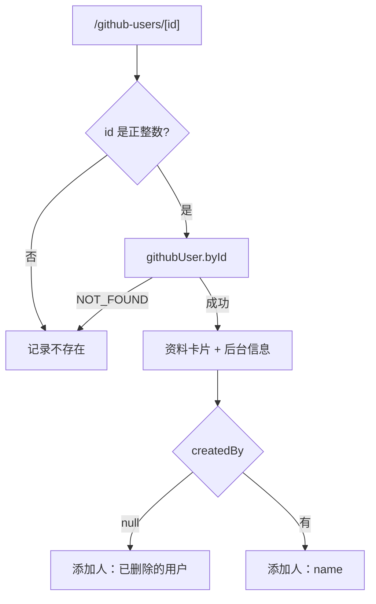

# R06 用户详情 - 技术设计

> 技术参考：[AGENTS.md](../../AGENTS.md)　需求：[docs/需求.md](../../docs/需求.md) REQ-06、第 7 节

## 技术约定

- 接口加在 `githubUserRouter`，`protectedProcedure` + Zod 输入（AGENTS.md「架构与数据流」·tRPC）
- Better Auth 的 `user` 表由 `auth.prisma` 定义，不能给它加反向关联字段（AGENTS.md「架构与数据流」·数据库；PRD 第 5 节）
- Next.js 16 动态路由 `params` 为 Promise（AGENTS.md「注意事项」）
- 前端 `useTRPC()` + TanStack Query（AGENTS.md「技术栈」）

## 方案概述

- **`githubUser.byId({ id })`**：`findUnique({ where: { id } })`，没有就抛 `NOT_FOUND` / `RECORD_NOT_FOUND`。添加人单独查：`ctx.db.user.findUnique({ where: { id: record.createdById }, select: { id: true, name: true } })`（`createdById` 不建外键，所以不能用 `include`）。输出 `toRecordDto(record)` + `createdBy: { id, name } | null`。
- **页面** `/github-users/[id]`：`page.tsx`（服务端）读取 `params`，用 `z.coerce.number().int().positive()` 解析，不合法直接渲染「记录不存在」组件；合法则渲染客户端组件 `github-user-detail.tsx` 查询 `byId`（`meta.skipGlobalErrorToast`，错误在页面内显示）。
  - `RECORD_NOT_FOUND`：渲染同一个「记录不存在」组件（`apps/web/src/app/github-users/[id]/record-not-found.tsx`，含「返回列表」链接）。
  - 布局：上方是 R03 的 `github-profile-card.tsx`，下方是「后台信息」区块（备注、标签、添加人、添加时间、最后同步时间），右上角预留操作区（R07～R09 加按钮）。
- 数据请求在客户端做（和现有 `/dashboard` 的 `privateData` 一致）：tRPC 请求需要浏览器带跨域 Cookie 访问 `:3000`，服务端组件里取数据要额外转发 Cookie，技术参考未规定，暂按客户端请求。

## 涉及模块 / 文件

| 文件 | 改动 |
| --- | --- |
| `packages/api/src/routers/github-user.ts` | 新增 `byId` |
| `packages/api/src/routers/github-user.by-id.test.ts` | 新增测试 |
| `apps/web/src/app/github-users/[id]/page.tsx` | 新增 |
| `apps/web/src/app/github-users/[id]/github-user-detail.tsx` | 新增（客户端） |
| `apps/web/src/app/github-users/[id]/record-not-found.tsx` | 新增 |

## 数据模型

无变化。

## 接口设计

```ts
githubUser.byId: protectedProcedure
  .input(z.object({ id: z.number().int().positive() }))
  .query(...) => GithubUserRecordDto & { createdBy: { id: string; name: string } | null }
```

错误：`BAD_REQUEST`、`NOT_FOUND`（`RECORD_NOT_FOUND`）、`UNAUTHORIZED`。

## 关键流程



## 异常与边界情况

- `id` 超过 `Int` 上限（如 `99999999999`）：Zod 校验加 `.max(2147483647)`，超出视为不存在（前端不发请求）。
- 备注为空、无标签：分别显示「—」和「无标签」。
- 记录在别的会话中被删除后刷新：显示「记录不存在」。

## 风险与取舍

- 添加人多一次查询：单条详情可以接受。
