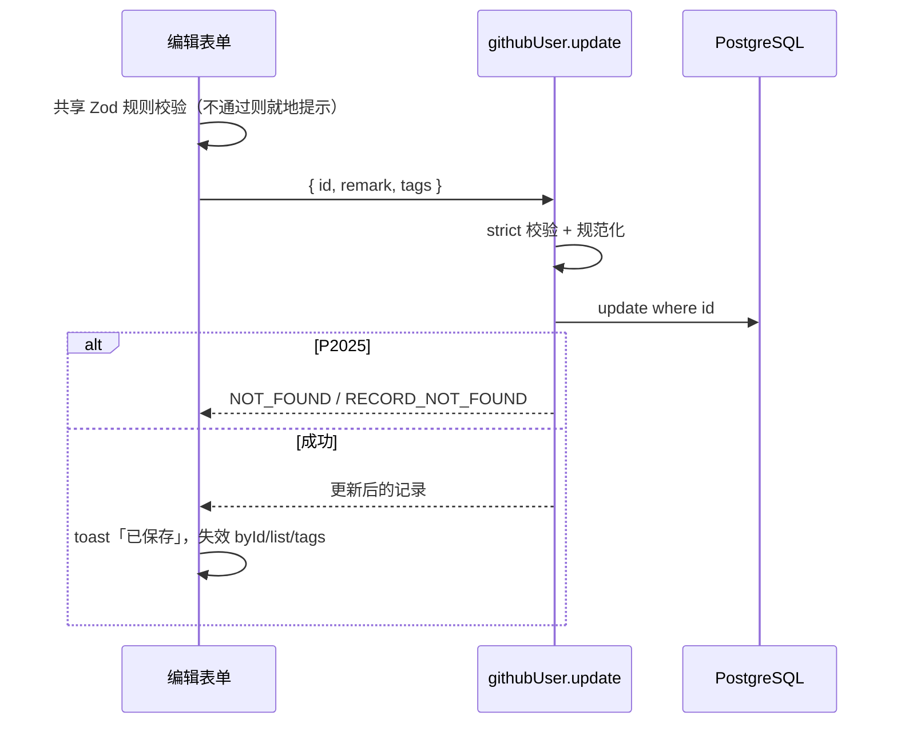

# R07 修改备注和标签 - 技术设计

> 技术参考：[AGENTS.md](../../AGENTS.md)　需求：[docs/需求.md](../../docs/需求.md) REQ-07、第 7 节

## 技术约定

- 接口加在 `githubUserRouter`，`protectedProcedure` + Zod 输入（AGENTS.md「架构与数据流」·tRPC）
- 表单用 TanStack Form + Zod 4（AGENTS.md「技术栈」）
- 共享 UI 组件用 shadcn 添加到 `packages/ui`（AGENTS.md「注意事项」）
- 表单输入要有 label（AGENTS.md「React & JSX」）
- 增删改错误在各自的地方处理（PRD 6.4）

## 方案概述

- **共享规则**（`packages/api/src/github/schemas.ts`，R00 已预留）：
  ```ts
  export const remarkSchema = z.string().trim().max(500, "备注最多 500 字")
    .transform((v) => (v === "" ? null : v)).nullable();
  export const tagsSchema = z.array(z.string().trim().max(20, "每个标签最多 20 字"))
    .transform((tags) => [...new Set(tags.filter((t) => t !== ""))])
    .pipe(z.array(z.string()).max(10, "最多 10 个标签"));
  export const githubUserUpdateInputSchema = z.object({
    id: z.number().int().positive(),
    remark: remarkSchema.optional(),
    tags: tagsSchema.optional(),
  }).strict(); // 多余字段 → BAD_REQUEST
  ```
  「最多 10 个」在去重、去空之后计算（技术参考未规定，暂按此）。标签去重区分大小写。
  - 实现调整：备注拆成 `remarkTextSchema`（只接受字符串，供编辑表单的字段校验用）和 `remarkSchema = remarkTextSchema.nullable()`（接口输入用），两者规则相同；`.strict()` 用 Zod 4 的等价写法 `z.strictObject(...)`；`id` 复用已有的 `githubUserIdSchema`。原因：TanStack Form 的备注字段值始终是字符串，表单校验不需要接受 `null`。
  - `P2025` 判断复用 R08 在 `@zyk-aws-admin/db` 中新增的 `isRecordNotFoundError`。
- **`githubUser.update`**：`ctx.db.githubUser.update({ where: { id }, data: { remark, tags } })`（`undefined` 的字段不更新）；捕获 `P2025` → `NOT_FOUND` / `RECORD_NOT_FOUND`。返回 `toRecordDto`。
- **编辑表单** `apps/web/src/components/github-users/edit-github-user-form.tsx`：备注 `Textarea`（显示字数）、标签输入（输入后回车或逗号添加为徽标，可删除；技术参考未规定，暂按此交互）。用同一套 Zod 规则校验。成功后 `toast.success("已保存")`，让 `byId`、`list`、`tags` 失效。
  - 详情页：后台信息区块的「编辑」按钮打开 `Dialog` 中的表单。
  - 列表行：操作列「编辑」按钮打开同一个 `Dialog`（PRD 第 3 节「在列表或详情页加备注和标签」；PRD 6.4 列出了 dialog 组件）。

## 涉及模块 / 文件

| 文件 | 改动 |
| --- | --- |
| `packages/api/src/github/schemas.ts` | 完善 `remarkSchema`、`tagsSchema`，新增 `githubUserUpdateInputSchema` |
| `packages/api/src/routers/github-user.ts` | 新增 `update` |
| `packages/api/src/routers/github-user.update.test.ts` | 新增测试 |
| `packages/ui/src/components/` | `npx shadcn@latest add dialog -c packages/ui` |
| `apps/web/src/components/github-users/edit-github-user-form.tsx` | 新增 |
| `apps/web/src/components/github-users/edit-github-user-dialog.tsx` | 新增：包一层 `Dialog` |
| `apps/web/src/app/github-users/[id]/github-user-detail.tsx` | 加「编辑」按钮 |
| `apps/web/src/app/github-users/github-user-list.tsx` | 操作列加「编辑」按钮 |

## 数据模型

无变化（`remark` 为 `VarChar(500)`，`tags` 为 `String[]`）。

## 接口设计

```ts
githubUser.update: protectedProcedure
  .input(githubUserUpdateInputSchema)   // { id, remark?: string | null, tags?: string[] }
  .mutation(...) => GithubUserRecordDto
```

错误：`BAD_REQUEST`、`NOT_FOUND`（`RECORD_NOT_FOUND`）、`UNAUTHORIZED`。

## 关键流程



## 异常与边界情况

- `remark: null` 表示清空；不传 `remark` 表示不改。
- 500 字按 JavaScript 字符串长度计（UTF-16 码元），与 PostgreSQL `VARCHAR(500)` 按字符计在常见中文、英文下一致；emoji 等代理对字符可能出现前端认为超长而数据库能存的情况，偏保守，可接受。
- 标签全部是空格：规范化后为 `[]`。
- 并发修改：后写覆盖先写（技术参考未规定，暂按此，不做乐观锁）。

## 风险与取舍

- 新增 shadcn 组件 `dialog`：PRD 6.4 已列出。
