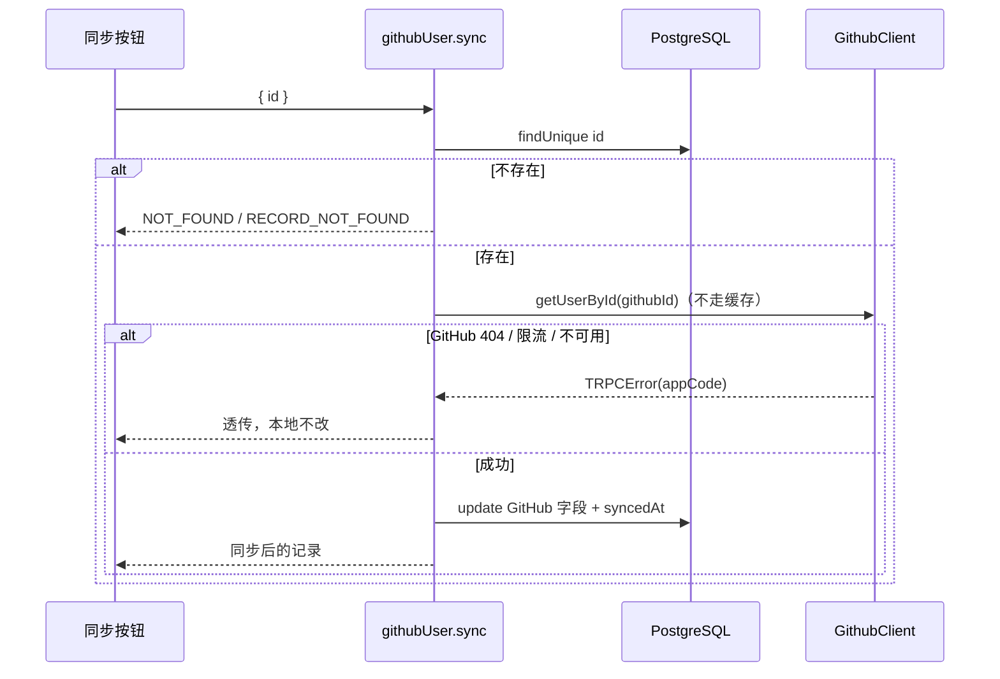

# R08 从 GitHub 同步 - 技术设计

> 技术参考：[AGENTS.md](../../AGENTS.md)　需求：[docs/需求.md](../../docs/需求.md) REQ-08、第 6.3 节、第 7 节

## 技术约定

- 接口加在 `githubUserRouter`，`protectedProcedure` + Zod 输入（AGENTS.md「架构与数据流」·tRPC）
- GitHub 调用通过上下文中的 `ctx.github`（R00；AGENTS.md「架构与数据流」·依赖注入）
- 增删改错误在各自的地方处理（PRD 6.4）

## 方案概述

`githubUser.sync({ id })`：

1. `findUnique({ where: { id } })`，不存在抛 `NOT_FOUND` / `RECORD_NOT_FOUND`（先查本地，避免为不存在的记录浪费 GitHub 额度）。
2. `ctx.github.getUserById(record.githubId)`（不走缓存）。GitHub 404 时客户端抛 `NOT_FOUND` / `GITHUB_USER_NOT_FOUND`，直接透传，本地不改。
3. `update({ where: { id }, data: { ...toGithubUserData(profile), syncedAt: new Date() } })`：`toGithubUserData` 只包含 GitHub 字段，不含 `remark`、`tags`、`createdById`。更新时 `P2025`（同步过程中被删除）→ `RECORD_NOT_FOUND`。
4. 返回 `toRecordDto`。

前端：`apps/web/src/components/github-users/sync-github-user-button.tsx`，列表行和详情页共用。成功 `toast.success("已同步")` 并让 `byId`、`list` 失效；失败按 `appCode` 提示，`GITHUB_USER_NOT_FOUND` 在同步场景显示「该账号在 GitHub 上已不存在」（R00 `app-error.ts` 的 `scene: "sync"`）。失败为 `RECORD_NOT_FOUND`（记录已被别处删除）时同样让 `byId`、`list` 失效，详情页随之显示「记录不存在」、列表去掉该行。详情页只在记录加载成功后显示按钮；列表操作列是「查看」+「同步」，按钮带读屏文字「：{login}」区分行。

> 实现时补充（2026-11-11）：P2025 判断放进 `@zyk-aws-admin/db` 的 `isRecordNotFoundError`，理由同 R04 的 `isUniqueConstraintError`（api 包不直接导入 Prisma）；增加 `RECORD_NOT_FOUND` 时失效查询，避免页面停留在已删除的记录上。

## 涉及模块 / 文件

| 文件 | 改动 |
| --- | --- |
| `packages/api/src/routers/github-user.ts` | 新增 `sync` |
| `packages/db/src/index.ts` | 新增 `isRecordNotFoundError(error)`（判断 P2025，和 `isUniqueConstraintError` 并列；api 包不直接依赖 Prisma 错误类） |
| `packages/api/src/routers/github-user.sync.test.ts` | 新增测试 |
| `apps/web/src/components/github-users/sync-github-user-button.tsx` | 新增 |
| `apps/web/src/app/github-users/[id]/github-user-detail.tsx` | 加「同步」按钮 |
| `apps/web/src/app/github-users/github-user-list.tsx` | 操作列加「同步」按钮 |

## 数据模型

无变化。同步更新的字段：GitHub 字段全部 + `syncedAt`；`updatedAt` 由 Prisma 自动更新。

## 接口设计

```ts
githubUser.sync: protectedProcedure
  .input(z.object({ id: z.number().int().positive() }))
  .mutation(...) => GithubUserRecordDto
```

错误：`NOT_FOUND`（`RECORD_NOT_FOUND` 或 `GITHUB_USER_NOT_FOUND`）、`TOO_MANY_REQUESTS`（`GITHUB_RATE_LIMITED`）、`BAD_GATEWAY`（`GITHUB_UNAVAILABLE`）、`BAD_REQUEST`、`UNAUTHORIZED`。

## 关键流程



## 异常与边界情况

- GitHub 返回的 `id` 与本地 `githubId` 不一致（理论上不会发生）：抛 `GITHUB_UNAVAILABLE` 并不写库（技术参考未规定，暂按此防御）。
- 改名后 `login` 与库中其他记录重复：`login` 没有唯一约束，正常保存（PRD 第 5 节说明）。
- 同步不刷新 R00 的资料缓存：缓存 60 秒自然过期即可。

## 风险与取舍

- 每次同步消耗一次资料查询额度（每小时 60/5000 次），按钮在请求中禁用，避免连点。
