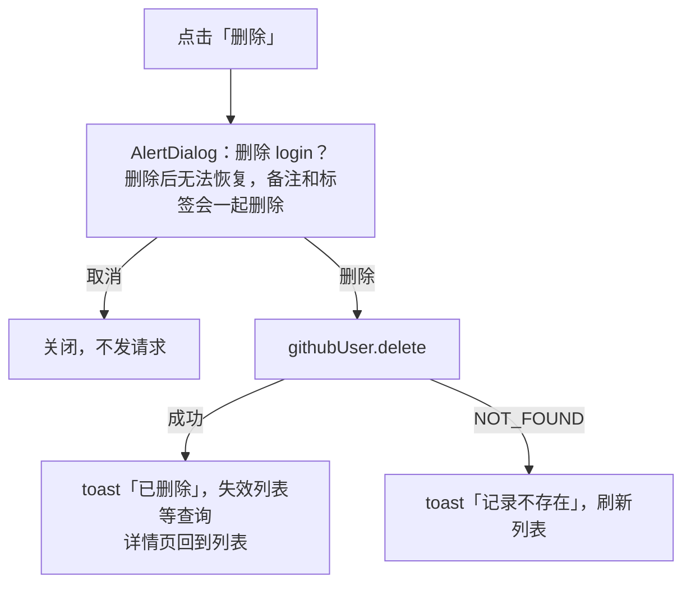

# R09 删除（物理删除） - 技术设计

> 技术参考：[AGENTS.md](../../AGENTS.md)　需求：[docs/需求.md](../../docs/需求.md) REQ-09、第 5 节、第 7 节

## 技术约定

- 接口加在 `githubUserRouter`，`protectedProcedure` + Zod 输入（AGENTS.md「架构与数据流」·tRPC）
- 共享 UI 组件用 shadcn 添加到 `packages/ui`（AGENTS.md「注意事项」）
- 增删改错误在各自的地方处理（PRD 6.4）

## 方案概述

- **`githubUser.delete({ id })`**：`ctx.db.githubUser.deleteMany({ where: { id } })`，删除行数为 0 时抛 `NOT_FOUND` / `RECORD_NOT_FOUND`。物理删除，没有 `deletedAt`（PRD 第 5 节、D2）。返回 `{ id }`。
  - 实现时由原方案「`delete` + 捕获 `P2025`」改为 `deleteMany` + 判断 `count`：同样是单条 DELETE 语句，并发删除时后到的删到 0 行；不依赖 `@prisma/adapter-pg` 下 P2025 的错误细节（R04 已发现驱动适配器的错误 meta 与经典引擎不同）。对外行为不变。
  - `id` 用与 `byId` 相同的 `githubUserIdSchema`（正整数，上限 `GITHUB_USER_ID_MAX`），超出时返回 `BAD_REQUEST`。
- **确认框** `apps/web/src/components/github-users/delete-github-user-dialog.tsx`：shadcn `AlertDialog`，标题「删除 <login>？」，正文「删除后无法恢复，备注和标签会一起删除」，按钮「取消」「删除」。只有点「删除」才调用 mutation；进行中禁用按钮。
  - 成功：`toast.success("已删除")`，让 `list`、`tags`、`byId`、`lookup`、`search` 失效（预览和搜索结果里的「已在名单中」会消失）；在详情页时 `router.push("/github-users")`。
    - 被删记录自己的 `byId` 只标记过期（`refetchType: "none"`），不立即重新请求，避免详情页跳走前闪一下「记录不存在」；以后再打开该详情时照常重新请求。（实现时补充）
  - `RECORD_NOT_FOUND`：`toast.error("记录不存在")`，同样让 `list` 等失效刷新；在详情页时回到列表。
  - 其他错误（网络等）：`toast.error(getAppErrorMessage(error))`，确认框保留，可以再试。
  - 失效的查询重新拉取完成后才关闭确认框，期间按钮保持禁用；同一帧内连点两次时 `disabled` 尚未渲染，另用 ref 保证只发一次请求（实现时补充，浏览器实测连点会发两次）。
  - 组件接收 `onDeleted` 回调（成功和 `RECORD_NOT_FOUND` 时调用）：详情页传入跳回列表，列表传入「当前页删空时页码减 1」。
- 列表行和详情页共用这个确认框组件。

## 涉及模块 / 文件

| 文件 | 改动 |
| --- | --- |
| `packages/api/src/routers/github-user.ts` | 新增 `delete` |
| `packages/api/src/routers/github-user.delete.test.ts` | 新增测试 |
| `packages/ui/src/components/` | `npx shadcn@latest add alert-dialog -c packages/ui` |
| `apps/web/src/components/github-users/delete-github-user-dialog.tsx` | 新增 |
| `apps/web/src/app/github-users/[id]/github-user-detail.tsx` | 加「删除」按钮 |
| `apps/web/src/app/github-users/github-user-list.tsx` | 操作列加「删除」按钮 |

## 数据模型

无变化（物理删除，`githubId` 唯一约束删除后立即释放）。

## 接口设计

```ts
githubUser.delete: protectedProcedure
  .input(z.object({ id: z.number().int().positive() }))
  .mutation(...) => { id: number }
```

错误：`NOT_FOUND`（`RECORD_NOT_FOUND`）、`BAD_REQUEST`、`UNAUTHORIZED`。

## 关键流程



## 异常与边界情况

- 两个会话同时删除同一条：后到的返回 `RECORD_NOT_FOUND`，前端按 R09-AC4 处理。
- 删除当前列表页的最后一条：列表刷新后该页为空时，前端把页码减 1（技术参考未规定，暂按此）。实现为：删除时当前页只有这一条且页码大于 1，就 `router.replace` 到上一页；第 1 页删空后显示 R05 的空状态。

## 风险与取舍

- 物理删除不可恢复（D2 已确认）：靠确认框明确提示降低误删。
- 新增 shadcn 组件 `alert-dialog`：PRD 6.4 已列出。
