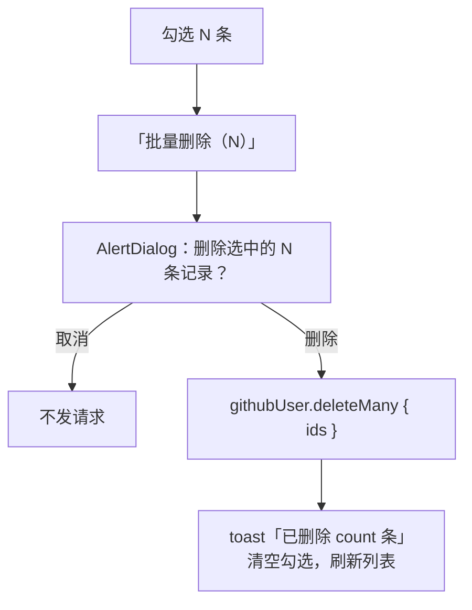

# R10 批量删除（P1） - 技术设计

> 技术参考：[AGENTS.md](../../AGENTS.md)　需求：[docs/需求.md](../../docs/需求.md) REQ-10、第 7 节

## 技术约定

- 接口加在 `githubUserRouter`，`protectedProcedure` + Zod 输入（AGENTS.md「架构与数据流」·tRPC）
- 勾选框使用 `packages/ui` 已有的 `checkbox` 组件，确认框使用 R09 添加的 `alert-dialog`（AGENTS.md「注意事项」）
- 表单控件有可访问的标签（AGENTS.md「React & JSX」）

## 方案概述

- **`githubUser.deleteMany({ ids })`**：`z.array(z.number().int().positive()).min(1).max(100)`，去重后 `ctx.db.githubUser.deleteMany({ where: { id: { in: ids } } })`，返回 `{ count }`。物理删除，不存在的 ID 自然被忽略。
- **前端**：`github-user-list.tsx` 中维护本页的勾选集合（`Set<number>`）。
  - 每行勾选框 `aria-label="选择 <login>"`；表头勾选框 `aria-label="全选本页"`，部分勾选时显示半选状态。
  - 有勾选时，筛选栏旁显示「批量删除（N）」按钮，点击打开 `AlertDialog`：「删除选中的 N 条记录？删除后无法恢复，备注和标签会一起删除」。
  - 成功：提示「已删除 <count> 条」，清空勾选，让 `list`、`tags`、`byId`、`lookup`、`search` 失效；当前页删空时页码减 1（沿用 R09）。
  - URL 参数（页码、筛选、排序、每页条数）变化时清空勾选。

## 涉及模块 / 文件

| 文件 | 改动 |
| --- | --- |
| `packages/api/src/routers/github-user.ts` | 新增 `deleteMany` |
| `packages/api/src/routers/github-user.delete-many.test.ts` | 新增测试 |
| `apps/web/src/app/github-users/github-user-list.tsx` | 勾选列、全选、批量删除按钮和确认框 |
| `apps/web/src/components/github-users/bulk-delete-dialog.tsx` | 新增 |

## 数据模型

无变化。

## 接口设计

```ts
githubUser.deleteMany: protectedProcedure
  .input(z.object({ ids: z.array(z.number().int().positive()).min(1).max(100) }))
  .mutation(...) => { count: number }
```

错误：`BAD_REQUEST`、`UNAUTHORIZED`。

## 关键流程



## 异常与边界情况

- `ids` 中有重复：服务端去重后再删，`count` 按实际删除数计算。
- 部分记录已被别人删掉：`count` 小于 N，提示里显示实际数量。
- 每页最多 50 条，勾选上限不会超过 100；接口上限仍然校验。

## 风险与取舍

- 只支持本页勾选，不做跨页全选，避免误删大量数据。
