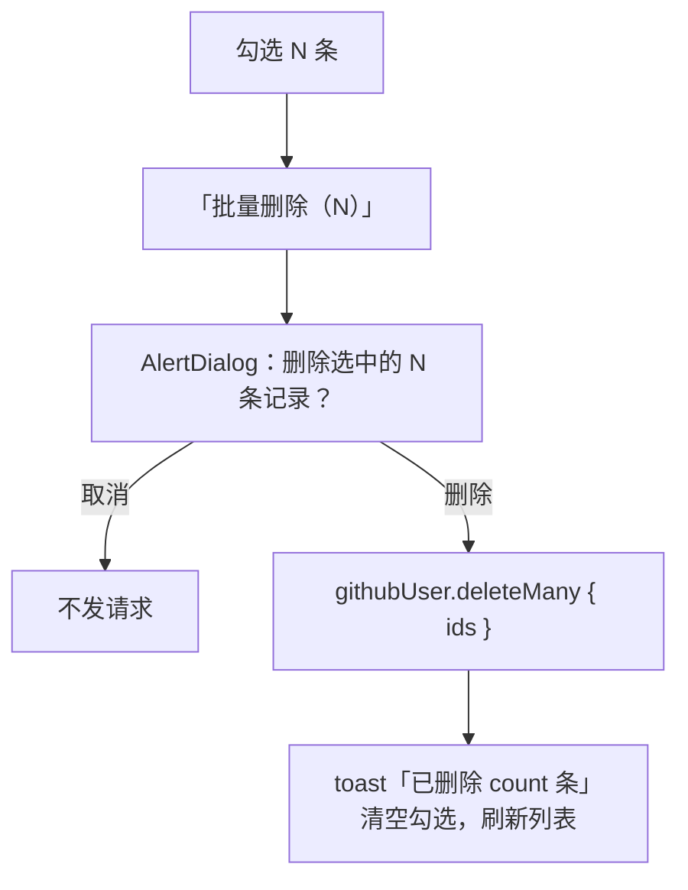

# R10 批量删除（P1） - 技术设计

> 技术参考：[AGENTS.md](../../AGENTS.md)　需求：[docs/需求.md](../../docs/需求.md) REQ-10、第 7 节

## 技术约定

- 接口加在 `githubUserRouter`，`protectedProcedure` + Zod 输入（AGENTS.md「架构与数据流」·tRPC）
- 勾选框使用 `packages/ui` 已有的 `checkbox` 组件，确认框使用 R09 添加的 `alert-dialog`（AGENTS.md「注意事项」）
- 表单控件有可访问的标签（AGENTS.md「React & JSX」）

## 方案概述

- **`githubUser.deleteMany({ ids })`**：输入 `githubUserDeleteManyInputSchema`（放在 `packages/api/src/github/schemas.ts`，元素复用 `githubUserIdSchema`，即正整数且不超过 Int 上限，避免超大 ID 让 Prisma 报错；数组 1～`GITHUB_USER_DELETE_MANY_MAX`=100 个），去重后 `ctx.db.githubUser.deleteMany({ where: { id: { in: ids } } })`，返回 `{ count }`。物理删除，不存在的 ID 自然被忽略。
- **前端**：`github-user-list.tsx` 中维护本页的勾选集合（`Set<number>`）。
  - 每行勾选框 `aria-label="选择 <login>"`；表头勾选框 `aria-label="全选本页"`，部分勾选时显示半选状态。
  - 有勾选时，筛选栏旁显示「批量删除（N）」按钮，点击打开 `AlertDialog`：「删除选中的 N 条记录？删除后无法恢复，备注和标签会一起删除」。
  - 成功：提示「已删除 <count> 条」，清空勾选，让 `list`、`tags`、`byId`、`lookup`、`search` 失效；当前页删空时退到最后一页（正常就是上一页，沿用 R09）。判断方式：不用 `total - count` 推算（别人先删掉了选中的记录时 `count` 偏小甚至为 0，而缓存里的 `total` 仍包含这些记录，会停在越界的空页）；删除时记下要纠正的列表参数（`listHref(params)`）和删除时刻，等该参数下的列表按删除后的数据刷新完（`dataUpdatedAt` 晚于删除时刻、不在请求中、不是占位数据），如果当前页 > 1、本页没有记录且刷新后的 `total` > 0，就用 `router.replace` 跳到 `Math.max(1, Math.ceil(total / pageSize))`，同步更新 URL 参数；`total` 为 0 时不跳转，显示空状态（无筛选时为「名单还是空的」）。也不用「本页全选」判断，因为删光非末页时后面的记录会补上来，不该退页。单条删除（R09）在原有「删掉本页最后一条退一页」之外也登记这一纠正（退页时登记退到的那一页），兜住别人同时删除导致退页后仍为空的情况；当前参数和登记的不一致时不做纠正。
  - URL 参数（页码、筛选、排序、每页条数）变化时清空勾选：勾选状态记下所属的 `listHref(params)`，和当前参数不一致就视为空，并在渲染时把状态重置到当前参数（不用 effect；只“视为空”不重置的话，翻页再翻回来旧勾选会恢复）。勾选数量只统计本页列表里还存在的 ID（单条删除、列表刷新后自动剔除）。
  - 确认框打开时记下当时勾选的 ID，标题数量和提交的 ID 都以它为准；确认框组件一直挂载，只在有勾选时渲染触发按钮，避免成功后清空勾选时确认框被直接卸载。

## 涉及模块 / 文件

| 文件 | 改动 |
| --- | --- |
| `packages/api/src/github/schemas.ts` | 新增 `GITHUB_USER_DELETE_MANY_MAX`、`githubUserDeleteManyInputSchema` |
| `packages/api/src/routers/github-user.ts` | 新增 `deleteMany` |
| `packages/api/src/routers/github-user.delete-many.test.ts` | 新增测试 |
| `apps/web/src/app/github-users/github-user-list.tsx` | 勾选列、全选、批量删除按钮和确认框 |
| `apps/web/src/components/github-users/bulk-delete-dialog.tsx` | 新增 `BulkDeleteGithubUsersDialog` |
| `packages/ui/src/components/checkbox.tsx` | 补上半选样式：`data-indeterminate` 时填充主色并显示横线图标（原组件半选时仍显示对勾、无底色；此前无任何地方使用该组件） |

## 数据模型

无变化。

## 接口设计

```ts
githubUser.deleteMany: protectedProcedure
  .input(githubUserDeleteManyInputSchema) // { ids: githubUserIdSchema[] }，1～100 个
  .mutation(...) => { count: number }
```

错误：`BAD_REQUEST`、`UNAUTHORIZED`。

## 关键流程



## 异常与边界情况

- `ids` 中有重复：服务端去重后再删，`count` 按实际删除数计算。
- 部分记录已被别人删掉：`count` 小于 N，提示里显示实际数量。
- 每页最多 50 条，勾选上限不会超过 100；接口上限仍然校验。

## 自测项（删除后的页码纠正）

- 非末页全选删除：后面的记录补上来，停在当前页。
- 末页全选删除：退回上一页，URL 的 `page` 同步更新。
- 选中记录已被别人先删除、`count`=0：例如共 12 条、每页 10 条，第 2 页 2 条全选后在库里先删掉这 2 条再确认，提示「已删除 0 条」，刷新后跳到第 1 页。
- 选中记录部分已被别人先删除：同上，在库里先删掉其中 1 条再确认，提示「已删除 1 条」，刷新后（剩 10 条）跳到第 1 页。
- 删除后 `total` 为 0：不跳转，显示空状态。
- 单条删除：删掉非第 1 页仅剩的一条退一页；别人同时删除导致退到的页也为空时，再跳到刷新后的最后一页。

## 风险与取舍

- 只支持本页勾选，不做跨页全选，避免误删大量数据。
